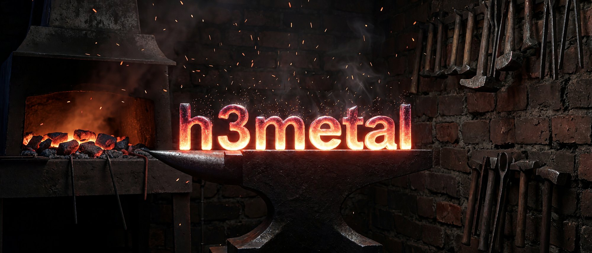

# h3metal

[](https://github.com/audenvenn/h3metal/actions/workflows/ci.yml)
[](LICENSE)

[MiniMax-H3-Image](https://huggingface.co/MiniMaxAI/MiniMax-H3-Image), the
33 B-parameter text-to-image and image-editing model, on Apple Silicon, with
its own Metal engine for the matrix units of the M5/M6 GPU.

<p align="center"></p>
<p align="center"><em>AI-generated by h3metal on a Mac mini (M6, 24 GB) in 48 s, 3136 x 1344 (<a href="docs/images/README.md">prompt</a>)</em></p>

On a Mac mini with an M6 (12-core GPU, 24 GB), a 2048 x 2048 image takes
41 s (46 s with a new prompt) and a 4096 x 4096 image 244 s: 2.8 and 1.9
times faster than [h3-image-mlx](https://github.com/Anionex/h3-image-mlx)
on the same machine, 4.5 times at 1024 x 1024.
The transformer, where nearly all of that time goes, runs at about three
quarters of what the GPU's matrix units can do at their measured peak. See
[Performance](#performance) and [Image quality](#image-quality).

## Quick start

Needs a Mac with Apple silicon and Metal 4 (macOS 26 or later), Python 3.10+
and the Xcode command line tools (pip fetches CMake and Ninja to build the
GPU runtime). The `python3` that comes with macOS is 3.9 and its pip rejects
the command below with "Invalid requirement": use a newer Python, from
python.org, Homebrew or uv. The matrix units h3metal is built for are in M5- and M6-class
GPUs; it is developed and measured on an M6.

```sh
pip install "h3metal @ git+https://github.com/audenvenn/h3metal"

h3metal download                       # the official checkpoint, ~125 GB
h3metal convert ~/.h3metal/checkpoint  # writes ~/.h3metal/model
h3metal generate -p "A red fox in fresh snow at sunrise" -o fox.png
h3metal generate -p "Put <Picture 1> on a beach at dusk" -i photo.jpg -o edit.png
```

The model comes with its own license, which limits where and how it may be
used: read [The model's license](#the-models-license) before downloading.
`h3metal download --source modelscope` fetches from ModelScope instead of
Hugging Face. Converting reads the checkpoint once; afterwards
`~/.h3metal/model` holds everything h3metal runs, 40-50 GB depending on the
transformer's format (44 GB on a 24 GB Mac, see
[Weight formats](#weight-formats)), and the checkpoint can be deleted.

## Usage

```sh
h3metal generate -p PROMPT [-s SIZE] [--seed N] [-n COUNT] [-o OUT.png] [-i REF.png ...]
```

- `-s` takes `WIDTHxHEIGHT` (multiples of 32), or an aspect ratio: `16:9` is
  MiniMax's recommended 16 MP size for that ratio (5472 x 3072), `16:9@2k`
  the same ratio at about 4 MP. The default is 2048 x 2048.
- Like the official pipeline, h3metal generates at 4 MP or more and resizes
  a smaller request back down afterwards, so `-s 1024x1024` costs as much as
  2048 x 2048; `--min-area 1024` generates at the requested size instead.
- `-n 4` makes four images with seeds `seed`, `seed + 1`, ...; the prompt is
  encoded once. Prompt embeddings are cached on disk (`~/.h3metal/cache`), so
  a repeated prompt skips the text encoder.
- `-i` makes it an edit. Repeat it for several references and name them
  `<Picture 1>`, `<Picture 2>`, ... in the prompt. References can be PNG, JPEG,
  WebP or anything else macOS opens, HEIC photos included.
- PNG output carries the prompt, seed and size, and says that the image is
  AI-generated, as the model's license asks.
- The very first run compiles the Metal kernels, which adds a few seconds;
  macOS caches them for later runs.

MiniMax-H3-Image expects a detailed English description of the whole image.
MiniMax's API expands short prompts first (H3-Image-Context-IR), and for
text-to-image MiniMax publishes a local prompt expander,
[MiniMax-H3-Image-PE](https://huggingface.co/MiniMaxAI/MiniMax-H3-Image-PE).
h3metal uses the prompt as given. For an edit, say what should stay as well
as what should change, including the exact wording of any text in the
picture: with only "keep all text unchanged", small lettering can come out
redrawn.

From Python:

```python
from h3metal import Pipeline
from PIL import Image

pipe = Pipeline("~/.h3metal/model")
image, timing = pipe.generate("A red fox in fresh snow at sunrise", 2048, 2048, seed=0)
Image.fromarray(image).save("fox.png")

edited, _ = pipe.edit("Put <Picture 1> on a beach at dusk", [Image.open("photo.jpg")], 2048, 2048)
```

Images come out as `uint8` arrays; `timing` says where the time went.

## How

- **Precomputed modulation.** Every transformer block projects the timestep
  into six modulation vectors through a 2688 x 96,768 matrix: 13.4 B
  parameters, a third of the transformer. The checkpoint samples on a fixed
  six-step grid, so the converter evaluates every vector the model can use
  and stores the tables (116 MB). Those parameters never reach the GPU.
- **Integer matrix products on the GPU's matrix units.** Weights in int8 or
  int4, activations quantized to int8 per row by the kernel that produces
  them, products accumulated in int32 by the hardware (Metal 4 tensor
  operations): nothing is dequantized in software.
- **Hadamard rotation** of every product's input spreads outlier channels
  before rounding; the random signs are folded into the weights and the
  modulation tables, so the rotation costs three register butterflies and
  five lane shuffles per 256 values.
- **Flash attention** with the operands in registers, the score product in
  int8, and the output's rescale skipped whenever no row's maximum moved.
- **One command buffer per block** over memory-mapped weights: only the block
  that runs is pinned. The 26 GB text encoder streams from the SSD with a
  footprint of half a gigabyte, and a transformer larger than the Mac's
  memory streams its blocks while others compute.
- **GPTQ**, optionally (`h3metal convert --gptq`, about an hour on an M6),
  chooses the 4-bit codes against real denoising trajectories.

[docs/design.md](docs/design.md) has the details, including what was tried
and did not pay.

## Weight formats

`h3metal convert` picks the transformer's format from the Mac's memory
(`--dit auto`), so that it stays in memory; text encoder, vision tower and
VAE are the same for all formats.

| `--dit` | Transformer | Chosen on | Error | 1024 x 1024 | 2048 x 2048 |
|---|---:|---|---:|---:|---:|
| `q8`: int8 | 20.8 GB | more than 24 GB | 0.13% | 36.2 s | 42.1 s |
| `mix`: int8 attention, int4 MLP | 14.9 GB | 24 GB | 0.25% | 8.6 s | 40.8 s |
| `q4`: int4 | 10.8 GB | 16 GB | 0.35% | 9.8 s | 43.0 s |

The error is the transformer's against the official module, on random
weights. Times are its six steps on the M6 (24 GB), generating at exactly
that size. There int8 does not fit in memory: the engine streams its blocks
from the SSD while others compute, which keeps up at 2048 x 2048 but not at
1024 x 1024. Once the products are compute-bound, int4 is a little slower
than int8 (the 4-bit codes are unpacked before every product): it is for
memory, not speed. The int4 times were taken with an int4 file derived from
the int8 one; the kernels are the same.

The text encoder keeps int8 weights with half-precision activations: its
output is within 0.37% of the official module run in float32 (mean over
nine prompts; per-token cosine 0.99996).

## Image quality

h3metal computes what the official pipeline computes, at lower precision.
Its tests compare each part with the official diffusers and transformers
modules (relative L2 error of the output):

| Part | Compared on | Error |
|---|---|---:|
| Transformer, `q8` (every step) | random weights | 0.13% |
| Transformer, `mix` | random weights | 0.25% |
| Transformer, `q4` | random weights | 0.35%; 0.26% with GPTQ |
| Text encoder | real weights, nine prompts, against float32 | 0.37% |
| Vision tower | real weights | 1.1% |
| VAE encoder | real weights | 0.28% |
| VAE decoder | real weights, against float32 | 79.1 dB PSNR |

An edit's inputs (tokens, rotary positions, the packed sequence) are
identical to the official pipeline's. On the real weights the three formats
give equally clean images; at the same seed, int4 weights move details
(where an animal's tail lies, the shading of a small object), as any change
in the numerics of a diffusion model does. Whole images have not been compared
with the official pipeline's yet: in bfloat16 it needs about 135 GB, and the
streamed reference runner in `tests/ref` is too slow on the CPU (an hour per
1024 x 1024 image) and does not yet fit the GPU of a 24 GB Mac
([details](docs/design.md#exactness)).

## Performance

### Against the hardware

The ceiling is what the GPU's matrix units do at their measured peak
(`bench/hw/mma_rate.py`): 42.0 TOPS for int8 products and 20.6 TFLOPS in
half precision on the M6's 12-core GPU. One transformer block with int8
weights (`bench/dit_layer_bench.py`):

| | 2048 x 2048 | 4096 x 4096 |
|---|---:|---:|
| Matrix products | 34.9 TOPS, 83% of peak | 34.7 TOPS, 83% of peak |
| Attention (int8 scores, half-precision P V) | 71% of peak | 73% of peak |
| Norms, rotary embedding, rotations | 5% of the time | 3% of the time |
| Whole block | 132.5 ms, 76% of the floor | 780.4 ms, 76% of the floor |

The floor is the time the matrix units would need at peak for the block's
products and attention, with everything else free: 100.7 ms at
2048 x 2048, 594.9 ms at 4096 x 4096. The rest of the gap is mostly the
attention's softmax, vector work the matrix units cannot take. With int4
weights the products reach 75-76% of the int8 peak; unpacking the 4-bit
codes costs time once a product is compute-bound. Every kernel's share is
in [docs/benchmarks.md](docs/benchmarks.md).

### Against h3-image-mlx

[h3-image-mlx](https://github.com/Anionex/h3-image-mlx) 0.1.0a3, the first
port of MiniMax-H3-Image to the Mac, on the same machine. Every run is a
fresh process timed from launch to the PNG on disk, and the two alternate
with pauses in between
([method](docs/benchmarks.md#end-to-end-against-h3-image-mlx)):

| Size | h3metal | h3-image-mlx | Speed-up |
|---|---:|---:|---:|
| 1024 x 1024 | 10.1 s | 45.7 s | 4.5x |
| 2048 x 2048 | 41.2 s | 115.4 s | 2.8x |
| 2048 x 2048, new prompt | 46.5 s | 118.1 s | 2.5x |
| 4096 x 4096 | 244.2 s | 458.3 s | 1.9x |

h3metal runs its default formats for a 24 GB Mac (int8 attention, int4
MLP). With int8 weights throughout, like h3-image-mlx's, it takes 45.0 s at
2048 x 2048 (2.6x). The gap narrows with size because attention, which
grows with the square of the number of rows, takes half of the time at
4096 x 4096.

## The model's license

h3metal's code is Apache-2.0. The model is not: MiniMax-H3-Image is licensed
under the [MiniMax-H3-Image Community License Agreement](https://huggingface.co/MiniMaxAI/MiniMax-H3-Image/blob/main/LICENSE),
which, among other terms, grants rights only within its Applicable
Territory (worldwide except the European Union, the United Kingdom, the
Republic of Korea and the United States of America), binds use to an
acceptable use policy, and asks that AI-generated images be disclosed as
such. You obtain the weights from MiniMax (`h3metal download` fetches them
from MiniMax's own repositories) and accept that license by doing so. Files
that `h3metal convert` writes are derivatives of the model and remain under
it.

## Contributing

See [CONTRIBUTING.md](CONTRIBUTING.md). Measured claims only: a change to
speed or numerics comes with the numbers and how they were taken.

## Acknowledgements

The reference implementations in
[diffusers](https://github.com/huggingface/diffusers) and
[transformers](https://github.com/huggingface/transformers) (Apache-2.0) are
what h3metal is tested against, and diffusers' conversion script documents
the original checkpoint's layout. The register layout of the matrix units'
SIMD-group operations is the one [MLX](https://github.com/ml-explore/mlx)'s
NAX kernels use. [h3-image-mlx](https://github.com/Anionex/h3-image-mlx)
showed MiniMax-H3-Image running on a Mac first and is the baseline h3metal
is measured against.
