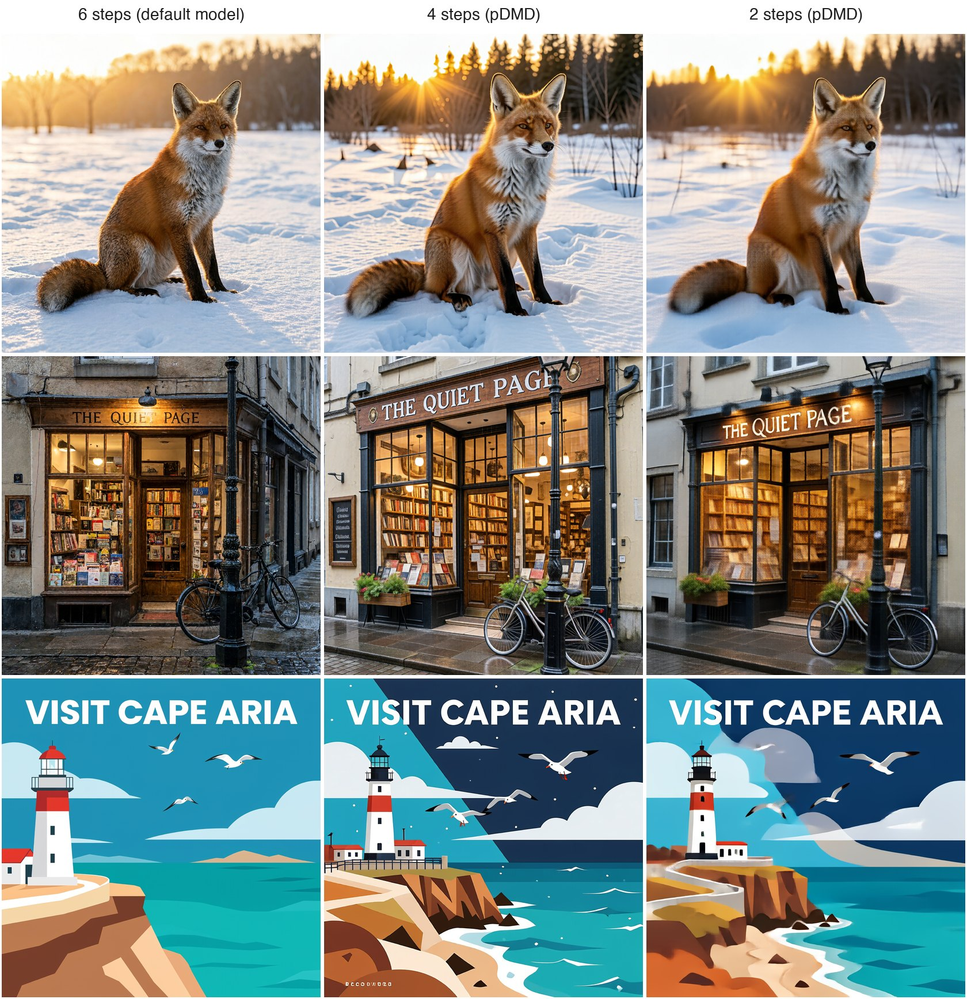

# MiniMax-H3-Image in 2, 3 or 4 steps

MiniMax-H3-Image is distilled to a fixed grid of six steps, with an output head for each step. pDMD's 2-step
LoRA ([pdmd2026/pdmd_2NFE_lora](https://huggingface.co/pdmd2026/pdmd_2NFE_lora), Apache-2.0,
[arXiv 2609.35768](https://arxiv.org/abs/2609.35768)) was distilled from MiniMax-H3, the video model that
MiniMax-H3-Image belongs to. It makes a finished picture in two transformer passes. MiniMax-H3-Image takes it as
a one-frame video, as ComfyUI does and as
[akhaliq/minimax-h3-image-pdmd-2step](https://huggingface.co/akhaliq/minimax-h3-image-pdmd-2step) showed first.

```sh
h3metal convert ~/.h3metal/checkpoint --pdmd   # writes dit-pdmd.h3m next to dit.h3m; fetches the LoRA (2.8 GB)
h3metal generate --steps 2 -p "..."            # or --steps 3 or 4; without --steps, the six-step model
```

The web page offers the step counts as well. The text encoder, the VAE and the vision tower are shared with the
six-step model; the few-step transformer adds 14.9 GB (int8 attention and int4 MLP on a 24 GB Mac). Converting it
reads the 66 GB transformer checkpoint once and took 4 minutes on an M6 Mac mini.

## What the conversion does

- **The adapter is merged into the weights**, in float32, before they are quantized. pDMD is meant for strength
  1.0 only, so it costs nothing at run time; style adapters stay separate low-rank terms
  ([lora.md](lora.md)). h3metal takes the fp32 file, the precision it was trained in (the bf16 file is a
  rounding of it). Its 312 pairs cover the attention and MLP matrices of the 50 blocks and of the token
  refiner. Its module names are diffusers'; the QKV rows are interleaved per head and the SwiGLU halves
  swapped back onto the checkpoint's layout. The checkpoint's own names (ComfyUI's conversion) work as well.
- **The transformer's own output head** (`final_layer.video_out`) replaces the six per-step heads.
- **The grids are diffusers' MiniMaxH3Scheduler's** with shift 12: `set_timesteps(N + 1)` for N steps, the
  operating point the adapter was trained for. The modulation of every block is computed at conversion for the
  timesteps of the 2-, 3- and 4-step grids, as for the six steps; the 13.4 B parameters of the AdaLN projections
  never reach the GPU.
- **The Euler update** is the scheduler's blend form, x0 from the timestep the transformer saw, then
  r x + (1 - r) x0, in float32.

## Checks

- **The premise.** On a one-frame image, MiniMax-H3-Image's transformer with the video model's output head
  computes exactly what the video transformer computes (diffusers' two classes, same weights: difference 0).
  h3metal's MiniMax-H3-Image transformer is the one tested against diffusers since 0.1.0.
- **A mini model** (`tests/ref/mini_dit_flow.py`, `tests/test_dit_flow_mini.py`): diffusers' video transformer
  with random weights and a random LoRA whose deltas are as large as their matrices.
  - The grids, and one update step, are bit for bit the scheduler's.
  - Every step's velocity is within 0.14-0.16% of the merged float32 model (int8 weights).
  - Without the merge the error is 3.9%. Breaking the mapping on purpose gives 3.7% (SwiGLU halves not swapped)
    and 1.9% (queries and keys exchanged).
  - The adapter in the checkpoint's own layout gives identical velocities.
- **Real weights, truncated** (`tests/ref/minimax_truncated.py`, `tests/test_minimax_truncated.py`): the token
  refiner, the first block, every embedding and the output layer, with pDMD's merged, against float32 on the
  CPU at both steps of the 2-step grid, with real caption features:

  | Relative error against float32 | step 1 (sigma 1) | step 2 (sigma 0.923) |
  |---|---:|---:|
  | int8, pDMD merged | 0.71% | 0.75% |
  | int8, base weights (calibration) | 0.74% | 0.77% |
  | int8 attention, int4 MLP, pDMD merged (default on 24 GB) | 1.25% | 1.58% |
  | int8 attention, int4 MLP, base weights | 1.26% | 1.60% |

  Merging the adapter costs no precision: the merged and the base weights are as close to float32 as each other.

## Speed

TABLE

## Images

<p align="center"></p>
<p align="center"><em>AI-generated by h3metal on a Mac mini (M6, 24 GB), 2048 x 2048, seed 42 (<a href="images/README.md">prompts</a>).</em></p>

Two steps get the composition, the light and the lettering right. At full size, fine texture can show a faint
crosshatch, and ComfyUI's bfloat16 renders with the same adapter show it too. Flat illustrations can get a
smeared or doubled shape (the clouds of the poster above). Four steps are cleaner, close to the six-step model,
which stays the default. The few-step transformer is a different model from the six-step one: the same seed
gives a different picture.

## License

pDMD's LoRA is Apache-2.0 (© the pDMD authors). h3metal downloads it, it does not ship it. The merged transformer
is a conversion of MiniMax-H3-Image and stays under its license (see the README).
